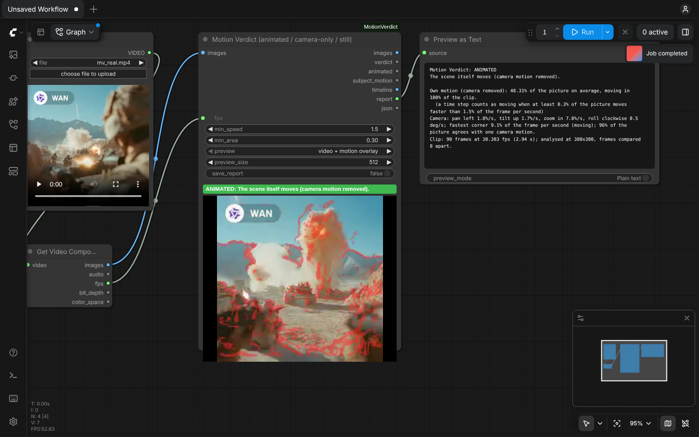
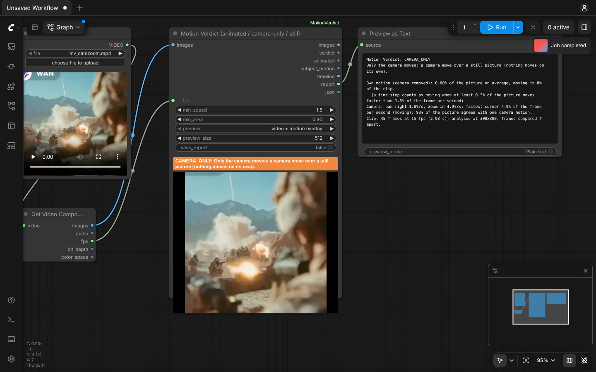

# Motion Verdict

**Is your AI video really animated, or is it only a camera move over a still picture?**

Image-to-video models (Wan, LTX, Hunyuan, MiniMax, Kling, ...) often return a clip where nothing moves. You
get a slow zoom or pan over the start image, a near-frozen clip, or a clip that moves for a second and then
stalls. Frozen-frame checks miss the zoom-over-a-still case, because the pixels *do* change.

**Motion Verdict removes the camera motion (pan, tilt, zoom, roll) first, then measures what still moves on its
own.**

| Real Wan clip → `ANIMATED` (what moves on its own is tinted red) | The same clip's first frame with only a zoom + pan → `CAMERA_ONLY` |
|---|---|
|  |  |

| Verdict | Meaning |
|---|---|
| `animated` | the scene itself moves for at least half of the clip |
| `partly_animated` | it moves, but only for part of the time (the stalls are listed) |
| `camera_only` | only the camera moves: a camera move over a still picture |
| `still` | nothing moves |
| `unknown` | fewer than 2 frames |

## What it does that other nodes don't

| | Frozen / duplicate-frame QC (VideoGate, frameaudit, ...) | Camera-move checkers (shotdrift, shotcheck) | Motion masks (optical flow, Motion Mask Tracker) | **Motion Verdict** |
|---|---|---|---|---|
| Catches "zoom over a still picture" | no (pixels change) | no (the camera did move) | no verdict | **yes: `camera_only`** |
| Measures motion with the camera removed | no | no | mask only | **yes: `subject_motion`** |
| Verdict + BOOLEAN for keeping or dropping a seed | frozen only | camera matches prompt | no | **animated / partly / camera_only / still** |
| Says when the motion stops | no | no | no | **stalls, with frame numbers** |
| Works in API / AI-App runs, without a player | yes | yes | yes | **yes** (STRING, BOOLEAN, FLOAT, IMAGE outputs) |

**Nearest nodes already on RunningHub** (checked with RunningHub's own node search):

| Node | What it does |
|---|---|
| RyanOnTheInside *Motion Feature* | motion amount from optical flow (its README documents no camera removal), as a signal that drives effects |
| DepthAnythingV3 *Parse Camera Pose* | camera pose from a depth model |
| WAS *Camera Motion Trajectory from Images* | **makes** a camera move over stills: the opposite of this node |
| MiniMax H3 *RAFT Motion Audit* / *Motion Quality Audit* | raw optical-flow motion / frame-delta freeze risk; their panels describe **no camera removal**, so a camera move over a still picture would count as motion |
| Video Stabilizer (Flow / Classic) | removes camera shake; its meta output records the camera motion that was removed, not how much the scene moves |

None of them removes the camera motion to judge whether the scene itself moves. Searches for Motion Mask
Tracker, shotdrift, shotcheck, VideoGate and frameaudit returned no node (56 search terms in total, see the research).

The full research is in [`research/DUPLICATE_RESEARCH.md`](research/DUPLICATE_RESEARCH.md).

## Use it
1. Add **Motion Verdict** (category `video/Motion Verdict`, node id `MotionVerdict`).
2. Connect `images` from *VAE Decode*, or from *Load Video → Get Video Components*. For the latter, also connect
   its `fps` output to `fps`.
3. Run. The node shows the verdict and a small preview, with the parts that move on their own tinted red.

Example workflow: [`examples/motion_verdict_load_video.json`](examples/motion_verdict_load_video.json). It was
exported from the ComfyUI UI; pick your own clip in *Load Video*.

### Inputs
| Input | Default | Meaning |
|---|---|---|
| `images` | | the clip (IMAGE batch) |
| `fps` | 16 | frames per second (Wan 16, LTX 24/25, Hunyuan 24) |
| `min_speed` | 1.5 | % of the frame per second that a pixel must move, after the camera is removed, to count. Raise it for grainy footage. |
| `min_area` | 0.3 | % of the (textured) picture that must move for a moment to count as "moving" |
| `preview` | video + motion overlay | on-node preview: `video + motion overlay`, `video` or `off` |
| `save_report` | off | also save the JSON report to `ComfyUI/output/motion_verdict/` |

### Outputs
| Output | Type | Meaning |
|---|---|---|
| `images` | IMAGE | the input, unchanged (passthrough) |
| `verdict` | STRING | `animated`, `partly_animated`, `camera_only`, `still` or `unknown` |
| `animated` | BOOLEAN | true only for `animated`; use it to keep or drop a seed |
| `subject_motion` | FLOAT | mean % of the picture that moves on its own |
| `timeline` | IMAGE | chart: green bars = own motion, blue line = camera speed, yellow dashes = `min_area`; bottom strip green = moving, red = not moving |
| `report` | STRING | readable report: verdict, own motion, camera pan / tilt / zoom / roll, stalls |
| `json` | STRING | every number plus the per-time-step timeline |

In API runs the node's own result (verdict, headline, report) is also in ComfyUI's `/history` under
`motion_verdict`.

## How it works
1. Each frame is shrunk to a ≤ 320 px greyscale copy, a few frames at a time, so memory stays small for
   long clips.
2. Frames ¼ s apart are compared. The camera motion between them is estimated as an affine transform:
   - phase correlation of the whole frame and of 45 tiles;
   - a robust fit that ignores tiles on a moving subject;
   - a robust polish on all pixels.
3. The later frame is warped back onto the earlier one and global brightness changes are removed. What still
   moves across edges faster than `min_speed` is "own motion".
4. The verdict comes from how much of the time at least `min_area` % of the picture moves on its own.

Formulas, thresholds and their reasons, edge cases and the memory plan are in
[`docs/DESIGN.md`](docs/DESIGN.md).

## Measured results
Measured on 4 CPU cores, no GPU. Full output is in [`tests/RESULTS.md`](tests/RESULTS.md).

**Speed**
- A Wan-size 5 s clip (81 frames at 832×480) takes **2.7 s**.
- 1,496 frames take 18 s.

**Unit tests:** **27/27 pass**. They cover planted pans, tilts, zooms, rolls and moving subjects, plus
noise / flicker / black false-positive tests and edge cases (0, 1 and 2 frames, odd and tiny sizes, C=1 and
C=4, NaN/Inf, 1,500 frames, 8-30 fps).

**Real AI video clips:**
- **230** example outputs of Wan, LTX, Seedance, Kling, MiniMax, Vidu, Hunyuan, PixVerse and others came back
  `animated` **229/230**. These are the animated thumbnails that ship with ComfyUI's templates, ≤ 512 px.
- The one exception (`partly_animated`) is a portrait that is motionless for its first 2.2 s.

**Known-answer clips built from real AI frames, re-encoded with H.264: 195/195 correct.** 39 of each:
- held frame → `still`;
- zoom + pan over the frame → `camera_only`;
- pan + tilt + roll over the frame → `camera_only`;
- 0.8 s of motion, then frozen → `partly_animated`;
- the real clip → `animated`.

**Thresholds are calibrated only on these clips.** They were **not** calibrated on full-resolution generations
or on real failed generations; none were available.

## Known limits
- **Parallax counts as motion.** A real 3-D camera move over a static scene is `animated`. Only a flat 2-D move
  over a still picture is `camera_only`.
- **Boiling texture, heavy grain or strong compression** can read as own motion. Raise `min_speed`.
- **Very slow motion** (under `min_speed`) and motion along an edge are under-counted.
- **Camera numbers are 2-D.** Pan vs truck and zoom vs dolly cannot be told apart.
- **Calibration data:** thresholds were tuned on synthetic clips and on small (≤ 512 px) thumbnails of real
  AI clips. They were **not** tuned on full-resolution user generations. Please report clips that get the
  wrong verdict.
- Tested only in Chromium; Firefox and Safari were not tested. Not tested on RunningHub itself.

## Requirements
- ComfyUI (tested with 0.43.0, frontend 1.57.6).
- Only `torch`, `numpy` and `av` (PyAV), which ComfyUI already installs. No other pip packages.
- Works on CPU-only machines. No network access.
- Writes nothing to disk unless `save_report` is on, and then only into ComfyUI's output folder.

## Install
`cd ComfyUI/custom_nodes` and `git clone` this repository. Then restart ComfyUI.

## Tests
- `python tests/test_motion_verdict.py`: known-answer tests with planted camera moves and moving subjects,
  false-positive tests and edge cases. ComfyUI is not needed.
- `python tests/eval_clips.py <folder>`: the verdict for every video in a folder.
- `python tests/derive_clips.py <real clips> <out>`: builds known-answer variants from real clips (still /
  camera move over a still frame / motion then freeze / re-encoded).
- `python tests/api_run.py <video>`: runs a workflow through a running ComfyUI's HTTP API (no browser).
- `node tests/ui_run.js <video> <png>`: drives the real UI in headless Chromium.

## Thanks
- **kijai** ([ComfyUI-KJNodes](https://github.com/kijai/ComfyUI-KJNodes)): his Fast Preview showed that a
  preview does not need to be written to disk. That idea is behind this node's in-memory preview. The code
  here is my own and does not come from KJNodes.
- The ComfyUI team, for the extensible server and frontend, and for the template thumbnails that were used as
  real-content calibration clips (not included in this repository).

## Licence
MIT. See [`LICENSE`](LICENSE).
